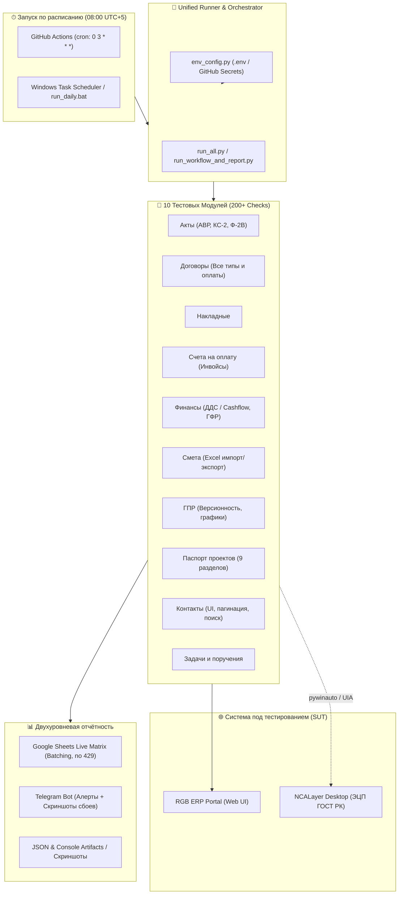

# 🏗️ RGB ERP Automation QA Test Suite

[](https://www.python.org/)
[](https://www.selenium.dev/)
[](https://docs.pytest.org/)
[](https://github.com/features/actions)
[](https://developers.google.com/sheets/api)
[](https://core.telegram.org/bots/api)

Комплексный фреймворк автоматизированного **End-to-End (E2E)** тестирования для корпоративного ERP-портала управления строительными проектами **RGB Group** (`testportal.rgbgroup.kz`).

Фреймворк покрывает **10 бизнес-модулей системы** (более 200 сквозных проверок) со сложными сценариями электронного документооборота, финансового учёта, матричной отчётностью в режиме реального времени и интеграцией с государственной системой цифровой подписи (ЭЦП ГОСТ РК через десктопный **NCALayer**).

---

## 📑 Содержание
1. [Архитектура решения](#-архитектура-решения)
2. [Охват тестирования (10 модулей, 200+ проверок)](#-охват-тестирования)
3. [Инженерные особенности и устойчивость](#-инженерные-особенности-и-устойчивость)
4. [Структура проекта](#-структура-проекта)
5. [Локальный запуск](#-локальный-запуск)
6. [Автономный запуск по расписанию (08:00 каждый день)](#-автономный-запуск-по-расписанию-0800)
7. [Безопасность и конфигурация окружения](#-безопасность-и-секреты)

---

## 🏛 Архитектура решения



---

## 🧪 Охват тестирования

В проекте автоматизированы как позитивные сценарии жизненного цикла документов, так и негативные проверки валидации форм:

| Модуль | Файл автотеста | Кол-во проверок | Ключевые сценарии и проверки |
|---|---|:---:|---|
| **Акты (АВР, КС-2, Ф-2В)** | `test-akt.py` | **69** | Создание по форме и произвольно, расчёт НДС (0%, 16%, без НДС), проверка полей карточки, маршрут согласования, подписание ЭЦП (2 подписанта) и бумажное подписание, валидация пустых форм и обязательного PDF. |
| **Финансы (ДДС / ГФР)** | `finance.py` | **27** | ДДС Cashflow, графики финансирования работ (ГФР), расчёты баланса, импорт/экспорт Excel, смена статусов, аналитика. |
| **Сметы** | `smeta.py` | **21** | Создание смет, дублирование (до 40 смет), парсинг и импорт Excel-шаблонов, 6 негативных тестов валидации, маршрут утверждения. |
| **ГПР (Графики работ)** | `gpr_test.py` | **21** | Управление версиями графиков производства работ, изменение причин корректировки, добавление строк, подписание ЭЦП через NCALayer. |
| **Контакты** | `contacts_test.py` | **25** | UI-тесты справочника: живой поиск без Enter, регистронезависимость, поиск телефонов от 6 цифр, пагинация (10/20/30/40), переключение «Сетка/Лист». |
| **Договоры** | `contract_workflow_new_design.py` | **20** | Виды: услуги, поставка, импорт, бартер; типы оплаты: 100% предоплата, постоплата (залог/гарантия), частичные платежи; загрузка PDF, маршруты согласования и ЭЦП. |
| **Паспорт проектов** | `pasportProjects.py` | **13** | 9-шаговый мастер создания паспорта объекта: площади, атрибуты (7 вкладок), документация, земельные участки, сроки, ответственные лица, фото/рендеры (6 шт.). |
| **Накладные** | `waybill_workflow_new_design.py` | **10** | Заполнение номенклатуры материалов, ставки НДС, генерация документа, согласование и подписание. |
| **Счета на оплату** | `invoice_workflow_ecp.py` | **9** | Создание инвойсов, распределение платежей, привязка к договорам, электронное визирование. |
| **Задачи и поручения** | `zadashi.py` | **20+** | Поручения, строительные поручения, заявки на договор, вложения документов, контроль дедлайнов и календарные события. |

---

## ⚡ Инженерные особенности и устойчивость

### 1. Умная отчётность в Google Sheets без ошибки 429 (Quota Exceeded)
При запуске сотен проверок подряд прямое обращение к Google Sheets API для каждой ячейки гарантированно вызывает ошибку `429 Too Many Requests`. 
- В `sheet_reporter.py` реализована **пакетная сборка (Batching)**: заголовки и структура читаются за 1 сетевой запрос, а обновление матрицы результатов за текущую дату (`DD.MM.YYYY`) выполняется одним `batch_update`.
- Автоматически создаётся новая колонка с датой прогона с копированием стилей, валидации данных и ширины колонок.
- Реализован механизм **Exponential Backoff & Retry** на случай временных задержек сети.

### 2. Моментальные Telegram-уведомления с диагностикой
- При успешном прогоне отправляется компактный отчёт со статусом.
- При сбоях Telegram-сообщение содержит список только упавших проверок с конкретными причинами, HTML-форматированием (с защитой от превышения лимита 4096 символов).
- К упавшему тесту бот автоматически прикрепляет **свежий скриншот экрана** в момент падения (`screens/debug_*.png`).

### 3. Автоматизация десктопного NCALayer (ЭЦП Казахстана)
Для подписания документов ключами ГОСТ РК в тестах реализован гибридный подход:
- Selenium управляет браузером Chrome.
- Десктопные всплывающие окна авторизации и выбора ключей NCALayer автоматизируются нативно через Windows UI Automation (`pywinauto`).
- Поддерживается запуск в режиме `--headless` или `--creation-only` для облачных CI-раннеров без физического NCALayer.

### 4. Динамические ожидания
Вместо хрупких задержек `time.sleep()` и тяжёлых `implicitly_wait` используется связка `WebDriverWait` с точечными `expected_conditions`, что предотвращает флакующие тесты (flaky tests) и ускоряет прогон.

---

## 📁 Структура проекта

```text
├── .github/
│   └── workflows/
│       └── daily-autotests.yml       # CI/CD: расписание в 08:00 утра + ручной запуск
├── env_config.py                     # Безопасный загрузчик настроек (.env / Secrets)
├── .env.example                      # Шаблон переменных окружения
├── requirements.txt                  # Зависимости проекта
├── run_all.py                        # Единая точка запуска тестов и матрицы CI
├── run_daily.bat                     # Скрипт запуска для Планировщика Windows
├── run_workflow_and_report.py        # Оркестратор отчётов (Sheets + Telegram)
├── sheet_reporter.py                 # Клиент Google Sheets API с батчингом
│
├── contacts_test.py                  # Модуль «Контакты»
├── test-akt.py                       # Модуль «Акты (АВР, КС-2, Ф-2В)»
├── finance.py                        # Модуль «Финансы (ДДС / ГФР)»
├── smeta.py                          # Модуль «Сметы»
├── gpr_test.py                       # Модуль «Графики работ (ГПР)»
├── pasportProjects.py                # Модуль «Паспорт проектов»
├── contract_workflow_new_design.py   # Модуль «Договоры»
├── waybill_workflow_new_design.py    # Модуль «Накладные»
├── invoice_workflow_ecp.py           # Модуль «Счета на оплату»
└── zadashi.py                        # Модуль «Задачи и поручения»
```

---

## 🚀 Локальный запуск

### 1. Клонирование и установка зависимостей
```bash
git clone <URL_ВАШЕГО_РЕПОЗИТОРИЯ>
cd RGB_Test

# Создание виртуального окружения
python -m venv venv
# Активация: venv\Scripts\activate (Windows) или source venv/bin/activate (macOS/Linux)

# Установка библиотек
pip install -r requirements.txt
```

### 2. Настройка конфигурации
Скопируйте шаблон `.env.example` в `.env`:
```bash
cp .env.example .env    # Linux / macOS
copy .env.example .env  # Windows
```
Заполните параметры в `.env` (логины, токен Telegram, ID Google-таблицы).

### 3. Запуск тестов

- **Посмотреть список всех модулей:**
  ```bash
  python run_all.py --list
  ```

- **Запуск всех модулей подряд:**
  ```bash
  python run_all.py
  ```

- **Запуск только веб-модулей (без требований к NCALayer):**
  ```bash
  python run_all.py --web-only
  ```

- **Запуск конкретных модулей:**
  ```bash
  python run_all.py contacts smeta finance
  ```

- **Запуск одного модуля в режиме Headless (без открытия окна Chrome):**
  ```bash
  HEADLESS=1 python run_all.py contacts
  ```

---

## ⏰ Автономный запуск по расписанию (08:00)

### Вариант 1: GitHub Actions (Облако или Self-Hosted)

В репозитории настроен workflow `.github/workflows/daily-autotests.yml`:
* **Расписание**: `cron: '0 3 * * *'` — каждый день в **03:00 UTC** (что строго соответствует **08:00 утра по часовому поясу Казахстана UTC+5**).
* **Ручной запуск**: Вкладка **Actions** → **Daily ERP Autotests** → кнопка **Run workflow** (с возможностью выбрать запуск конкретных модулей).

#### Настройка GitHub Secrets:
В настройках вашего GitHub репозитория перейдите в **Settings** → **Secrets and variables** → **Actions** → **New repository secret** и добавьте:
* `RGB_ACCOUNT1_LOGIN`, `RGB_ACCOUNT1_PASSWORD`, `RGB_ACCOUNT1_PASSWORD_ALT`
* `RGB_ACCOUNT2_LOGIN`, `RGB_ACCOUNT2_PASSWORD`
* `RGB_ACCOUNT3_LOGIN`, `RGB_ACCOUNT3_PASSWORD`
* `TG_TOKEN`, `TG_CHATS`
* `GOOGLE_SPREADSHEET_ID`
* `GOOGLE_SERVICE_ACCOUNT_JSON` — содержимое файла `service_account.json` целиком (одной строкой).

> [!TIP]
> **Для тестов с NCALayer**:
> Если требуется полный прогон с реальным подписанием ЭЦП по расписанию, подключите ваш Windows-компьютер/сервер как **GitHub Self-Hosted Runner** (**Settings** → **Actions** → **Runners** → **New self-hosted runner**) и укажите переменную `AUTOTEST_RUNNER=self-hosted`.

---

### Вариант 2: Планировщик заданий Windows (Task Scheduler)
Если тесты должны стабильно крутиться на выделенном рабочем ПК с установленным NCALayer без сторонних облаков:

1. Откройте **Планировщик заданий** в Windows (`taskschd.msc`).
2. Нажмите **Создать базовую задачу** (Create Basic Task):
   * Имя: `RGB_Daily_Autotests`
   * Триггер: **Ежедневно в 08:00**.
   * Действие: **Запустить программу**.
   * Программа: укажите путь к `run_daily.bat` (например, `C:\Users\Administrator\Desktop\RGB_Test\run_daily.bat`).
   * Рабочая папка: `C:\Users\Administrator\Desktop\RGB_Test`.
3. Готово! Каждое утро в 8:00 скрипт запустит прогон, внесёт записи в Google Таблицу и пришлёт отчёт в Telegram.

---

## 🔒 Безопасность и секреты

* Проект строго следует принципу **Zero Secrets in Code**.
* Файл `.gitignore` гарантирует, что локальные файлы `.env`, приватные ключи Google API (`service_account.json`), ключи ЭЦП (`*.p12`), логи (`logs/`) и скриншоты (`screens/`) **никогда не попадут в открытый git-репозиторий**.
* Для быстрого старта новых членов команды предусмотрен безопасный шаблон [.env.example](.env.example).

---

## 👨‍💻 Автор / QA Automation Engineer
- **Автор:** Sharipzhan Margulan
- **Роль:** QA Lead / QA Automation Engineer
- **Стек:** Python, Selenium WebDriver, Pytest, GitHub Actions, Google Sheets API, Telegram Bot API, Desktop Automation (pywinauto/UIA).
