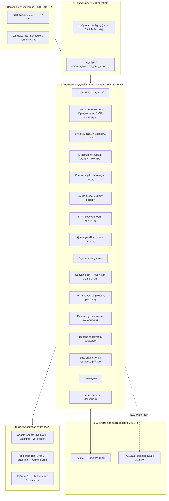

# 🏗️ RGB ERP Automation QA Test Suite

[](https://www.python.org/)
[](https://www.selenium.dev/)
[](https://docs.pytest.org/)
[](https://github.com/features/actions)
[](https://developers.google.com/sheets/api)
[](https://core.telegram.org/bots/api)

Комплексный фреймворк автоматизированного **End-to-End (E2E)** тестирования для корпоративного ERP-портала управления строительными проектами **RGB Group** (`testportal.rgbgroup.kz`).

Фреймворк покрывает **16 бизнес-модулей системы** (более **330 сквозных проверок**) со сложными сценариями электронного документооборота, снабжения, контроля качества (Предписания, БиОТ, Инспекции), финансового учёта (ДДС и ГФР), внутренних коммуникаций (Обсуждения, WIKI, Новости, Панель руководителя), матричной отчётностью в режиме реального времени и интеграцией с государственной системой цифровой подписи (ЭЦП ГОСТ РК через десктопный **NCALayer**).

---

## 📑 Содержание
1. [Архитектура решения](#-архитектура-решения)
2. [Охват тестирования (16 модулей, 330+ проверок)](#-охват-тестирования)
3. [Инженерные особенности и устойчивость](#-инженерные-особенности-и-устойчивость)
4. [Структура проекта](#-структура-проекта)
5. [Локальный запуск](#-локальный-запуск)
6. [Автономный запуск по расписанию (08:00 каждый день)](#-автономный-запуск-по-расписанию-0800)
7. [Безопасность и конфигурация окружения](#-безопасность-и-секреты)

---

## 🏛 Архитектура решения



---

## 🧪 Охват тестирования

В проекте автоматизированы как позитивные сценарии жизненного цикла документов, так и негативные проверки валидации форм и ролевого доступа:

| № | Модуль (ключ `run_all.py`) | Файл автотеста и JSON-схема | Кол-во проверок | Диапазон в Google Sheets | Ключевые сценарии и проверки |
|:---:|---|---|:---:|:---:|---|
| 1 | **Акты (`acts`)** | `tests/acts/test-akt.py` | **69** | `144–212` | АВР, КС-2, Ф-2В: создание по форме и произвольно, расчёт НДС (0%, 16%, без НДС), маршрут согласования, подписание ЭЦП и бумажное, валидация пустых форм и PDF. |
| 2 | **Контроль качества (`quality`)** | `tests/quality/quality.py`<br>`quality_checks.json` | **35** | `332–366` | Предписания, БиОТ, Инспекции скрытых работ: черновики, вложения, назначение участников, исполнение/возврат/завершение по ролям, критичные и приостановка. |
| 3 | **Финансы (`finance`)** | `tests/finance/finance.py`<br>`finance_checks.json` | **27** | `240–266` | ДДС Cashflow, графики финансирования работ (ГФР) по 4 основаниям (Без основания, Смета, ГПР, Excel), маршрут согласования, импорт/экспорт Excel. |
| 4 | **Снабжение (`supply`)** | `tests/supply/supply.py`<br>`supply_checks.json` | **25** | `305–330` | Заявки на снабжение (позиции, соисполнитель, маршрут, поставщик, НДС 16%, склад, приёмка ТМЦ, закрытие), Остатки на складе, Заказы на технику. |
| 5 | **Контакты (`contacts`)** | `tests/contacts/contacts_test.py`<br>`contacts_checks.json` | **25** | `213–237` | Живой поиск без Enter, регистронезависимость, поиск телефонов от 6 цифр, пагинация (10/20/30/40), переключение «Сетка/Лист», проверка карточек. |
| 6 | **Смета (`smeta`)** | `tests/smeta/smeta.py`<br>`smeta_checks.json` | **21** | `269–289` | Создание смет, дублирование, парсинг и импорт Excel-шаблонов, негативные тесты валидации, маршрут согласования и утверждения, АВР. |
| 7 | **ГПР (`gpr`)** | `tests/gpr/gpr_test.py` | **21** | `122–142` | Управление версиями графиков производства работ, изменение причин корректировки, добавление строк, согласование и подписание. |
| 8 | **Договоры (`contracts`)** | `tests/contracts/contract_workflow_new_design.py` | **20** | `57–76` | Виды: услуги, поставка, импорт, бартер; типы оплаты: 100% предоплата, постоплата (залог/гарантия), частичные платежи; PDF, маршрут и ЭЦП. |
| 9 | **Задачи и поручения (`tasks`)** | `tests/tasks/zadashi.py` | **20+** | `90–119` | Создание задач и поручений всех типов, подзадачи, вложения документов, делегирование, смена статусов и календарные события. |
| 10 | **Обсуждения (`discussions`)** | `tests/discussions/obsuzhdenie.py`<br>`discussions_checks.json` | **18** | `369–386` | Вкладки Все/Публичные/Закрытые, фильтр «Только мои», создание публичных и закрытых тем с PDF, ответы, проверка доступа (403 для посторонних и удалённых). |
| 11 | **Лента новостей (`news`)** | `tests/news/news.py`<br>`news_checks.json` | **17** | `402–418` | Фильтры, тренды, поиск, пагинация, создание новости с генерацией обложки и фото (Pillow), форматирование текста, PDF/TXT, лайки и комментарии. |
| 12 | **Панель руководителя (`manager`)** | `tests/manager/panelrukovoditelya.py`<br>`manager_checks.json` | **16** | `421–436` | Аналитика по 4 вкладкам (Задачи, Финансы, Контроль качества, Снабжение), сверка формул и итогов пользователей/объектов, фильтры и сортировка. |
| 13 | **Паспорт проектов (`passport`)** | `tests/passport/pasportProjects.py`<br>`passport_checks.json` | **13** | `291–303` | 9-шаговый мастер создания паспорта объекта: площади, атрибуты (7 вкладок), документация, земельные участки, сроки, команда, фото/рендеры. |
| 14 | **База знаний WIKI (`wiki`)** | `tests/wiki/wiki.py`<br>`wiki_checks.json` | **11** | `389–399` | Режим чтения: счётчики разделов и папок, раскрытие дерева иерархии, обход структуры и файлов, режимы «Список/Сетка», поиск и сортировка. |
| 15 | **Накладные (`waybills`)** | `tests/waybills/waybill_workflow_new_design.py` | **10** | `46–55` | Заполнение номенклатуры материалов, ставки НДС, генерация документа, согласование и подписание. |
| 16 | **Счета на оплату (`invoices`)** | `tests/invoices/invoice_workflow_ecp.py` | **9** | `79–87` | Создание заявок на оплату (счетов/инвойсов), распределение платежей, привязка к договорам, маршрут согласования. |

---

## ⚡ Инженерные особенности и устойчивость

### 1. Умная отчётность в Google Sheets без ошибки 429 (Quota Exceeded)
При запуске сотен проверок подряд прямое обращение к Google Sheets API для каждой ячейки гарантированно вызывает ошибку `429 Too Many Requests`. 
- В `sheet_reporter.py` реализована **пакетная сборка (Batching)**: заголовки и структура читаются за 1 сетевой запрос, а обновление матрицы результатов за текущую дату (`DD.MM.YYYY`) выполняется одним `batch_update`.
- Автоматически создаётся новая колонка с датой прогона с копированием стилей, валидации данных и ширины колонок.
- Реализован механизм **Exponential Backoff & Retry** на случай временных задержек сети.

### 2. Моментальные Telegram-уведомления с диагностикой
- При успешном прогоне отправляется компактный отчёт со статусом.
- При сбоях Telegram-сообщение содержит список только упавших проверок с конкретными причинами, HTML-форматированием (с защитой от превышения лимита 4096 символов).
- К упавшему тесту бот автоматически прикрепляет **свежий скриншот экрана** в момент падения (`screens/debug_*.png`).

### 3. Автоматизация десктопного NCALayer (ЭЦП Казахстана)
Для подписания документов ключами ГОСТ РК в тестах реализован гибридный подход:
- Selenium управляет браузером Chrome.
- Десктопные всплывающие окна авторизации и выбора ключей NCALayer автоматизируются нативно через Windows UI Automation (`pywinauto`).
- Поддерживается запуск в режиме `--headless` или `--creation-only` для облачных CI-раннеров без физического NCALayer.

### 4. Динамические ожидания
Вместо хрупких задержек `time.sleep()` и тяжёлых `implicitly_wait` используется связка `WebDriverWait` с точечными `expected_conditions`, что предотвращает флакующие тесты (flaky tests) и ускоряет прогон.

---

## 📁 Структура проекта

```text
├── .github/
│   └── workflows/
│       └── morning-autotests.yml   # CI/CD автоматизация (08:00 утра по Алматы, UTC+5)
├── config/
│   ├── env_config.py               # Безопасный загрузчик настроек (.env / GitHub Secrets)
│   └── .env.example                # Шаблон переменных окружения
├── core/                           # Ядро фреймворка и отчётность
│   ├── artifact_paths.py           # Централизованное управление путями логов и скринов
│   ├── quality_selection.py        # Селектор сценариев модуля Контроля качества
│   ├── sheet_reporter.py           # Клиент Google Sheets API с батчингом и верификацией
│   └── run_workflow_and_report.py  # Оркестратор прогонов (16 модулей -> Sheets + Telegram)
├── tests/                          # 16 тестовых модулей по бизнес-доменам
│   ├── acts/                       # Акты (АВР, КС-2, Ф-2В)
│   │   └── test-akt.py
│   ├── contacts/                   # Справочник контактов
│   │   ├── contacts_test.py
│   │   └── contacts_checks.json
│   ├── contracts/                  # Договоры (услуги, поставка, импорт, бартер)
│   │   └── contract_workflow_new_design.py
│   ├── discussions/                # Обсуждения (публичные и закрытые, права доступа)
│   │   ├── obsuzhdenie.py
│   │   └── discussions_checks.json
│   ├── finance/                    # ДДС (Cashflow) и ГФР
│   │   ├── finance.py
│   │   └── finance_checks.json
│   ├── gpr/                        # Графики производства работ (ГПР)
│   │   └── gpr_test.py
│   ├── invoices/                   # Счета на оплату / Инвойсы
│   │   └── invoice_workflow_ecp.py
│   ├── manager/                    # Панель руководителя (4 вкладки аналитики)
│   │   ├── panelrukovoditelya.py
│   │   └── manager_checks.json
│   ├── news/                       # Лента новостей (публикация, обложки, реакции)
│   │   ├── news.py
│   │   └── news_checks.json
│   ├── passport/                   # Паспорт проектов (9 вкладок)
│   │   ├── pasportProjects.py
│   │   └── passport_checks.json
│   ├── quality/                    # Контроль качества (Предписания, БиОТ, Инспекции)
│   │   ├── quality.py
│   │   ├── quality_checks.json
│   │   └── quality_selection.py
│   ├── smeta/                      # Сметы (создание, дублирование, Excel-импорт)
│   │   ├── smeta.py
│   │   └── smeta_checks.json
│   ├── supply/                     # Снабжение (Заявки, Остатки, Техника)
│   │   ├── supply.py
│   │   └── supply_checks.json
│   ├── tasks/                      # Задачи, поручения и календарь
│   │   └── zadashi.py
│   ├── waybills/                   # Накладные
│   │   └── waybill_workflow_new_design.py
│   └── wiki/                       # База знаний WIKI (дерево разделов и файлов)
│       ├── wiki.py
│       └── wiki_checks.json
├── docs/                           # Дополнительная документация по модулям
│   ├── CONTACTS_README.md
│   ├── FINANCE_README.md
│   └── SMETA_README.md
├── run_all.py                      # Главная точка входа: запуск всех 16 или выбранных модулей
├── run_daily.bat                   # Лаунчер для Планировщика заданий Windows
├── conftest.py                     # Конфигурация Pytest и хуки отчётности
├── requirements.txt                # Зависимости Python
├── README.md                       # Главное резюме и документация проекта
├── .gitignore                      # Исключения Git (Zero Secrets)
└── .gitattributes
```

---

## 🚀 Локальный запуск

### 1. Клонирование и установка зависимостей
```bash
git clone <URL_ВАШЕГО_РЕПОЗИТОРИЯ>
cd RGB_Test

# Создание виртуального окружения
python -m venv venv
# Активация: venv\Scripts\activate (Windows) или source venv/bin/activate (macOS/Linux)

# Установка библиотек
pip install -r requirements.txt
```

### 2. Настройка конфигурации
Скопируйте шаблон `.env.example` в `.env`:
```bash
cp .env.example .env    # Linux / macOS
copy .env.example .env  # Windows
```
Заполните параметры в `.env` (логины, токен Telegram, ID Google-таблицы).

### 3. Запуск тестов

- **Посмотреть список всех модулей:**
  ```bash
  python run_all.py --list
  ```

- **Запуск всех модулей подряд:**
  ```bash
  python run_all.py
  ```

- **Запуск только веб-модулей (без требований к NCALayer):**
  ```bash
  python run_all.py --web-only
  ```

- **Запуск конкретных модулей:**
  ```bash
  python run_all.py contacts supply quality discussions wiki news manager
  ```

- **Запуск отдельного модуля напрямую через оркестратор:**
  ```bash
  python core/run_workflow_and_report.py tests/supply/supply.py
  python core/run_workflow_and_report.py tests/quality/quality.py --only-fixed
  ```

- **Запуск одного модуля в режиме Headless (без открытия окна Chrome):**
  ```bash
  HEADLESS=1 python run_all.py contacts
  ```

---

## ⏰ Автономный запуск по расписанию (08:00)

### Вариант 1: GitHub Actions (Облако или Self-Hosted)

В репозитории настроен workflow `.github/workflows/morning-autotests.yml`:
* **Расписание**: `cron: '0 3 * * *'` — каждый день в **03:00 UTC** (что строго соответствует **08:00 утра по часовому поясу Казахстана UTC+5**).
* **Ручной запуск**: Вкладка **Actions** → **Daily ERP Autotests** → кнопка **Run workflow** (с возможностью выбрать запуск конкретных модулей).

#### Настройка GitHub Secrets:
В настройках вашего GitHub репозитория перейдите в **Settings** → **Secrets and variables** → **Actions** → **New repository secret** и добавьте:
* `RGB_ACCOUNT1_LOGIN`, `RGB_ACCOUNT1_PASSWORD`, `RGB_ACCOUNT1_PASSWORD_ALT`
* `RGB_ACCOUNT2_LOGIN`, `RGB_ACCOUNT2_PASSWORD`
* `RGB_ACCOUNT3_LOGIN`, `RGB_ACCOUNT3_PASSWORD`
* `TG_TOKEN`, `TG_CHATS`
* `GOOGLE_SPREADSHEET_ID`
* `GOOGLE_SERVICE_ACCOUNT_JSON` — содержимое файла `service_account.json` целиком (одной строкой).

> [!TIP]
> **Для тестов с NCALayer**:
> Если требуется полный прогон с реальным подписанием ЭЦП по расписанию, подключите ваш Windows-компьютер/сервер как **GitHub Self-Hosted Runner** (**Settings** → **Actions** → **Runners** → **New self-hosted runner**) и укажите переменную `AUTOTEST_RUNNER=self-hosted`.

---

### Вариант 2: Планировщик заданий Windows (Task Scheduler)
Если тесты должны стабильно крутиться на выделенном рабочем ПК с установленным NCALayer без сторонних облаков:

1. Откройте **Планировщик заданий** в Windows (`taskschd.msc`).
2. Нажмите **Создать базовую задачу** (Create Basic Task):
   * Имя: `RGB_Daily_Autotests`
   * Триггер: **Ежедневно в 08:00**.
   * Действие: **Запустить программу**.
   * Программа: укажите путь к `run_daily.bat` (например, `C:\Users\Administrator\Desktop\RGB_Test\run_daily.bat`).
   * Рабочая папка: `C:\Users\Administrator\Desktop\RGB_Test`.
3. Готово! Каждое утро в 8:00 скрипт запустит прогон, внесёт записи в Google Таблицу и пришлёт отчёт в Telegram.

---

## 🔒 Безопасность и секреты

* Проект строго следует принципу **Zero Secrets in Code**.
* Файл `.gitignore` гарантирует, что локальные файлы `.env`, приватные ключи Google API (`service_account.json`), ключи ЭЦП (`*.p12`), логи (`logs/`) и скриншоты (`screens/`) **никогда не попадут в открытый git-репозиторий**.
* Для быстрого старта новых членов команды предусмотрен безопасный шаблон [.env.example](.env.example).

---

## 👨‍💻 Автор / QA Automation Engineer
- **Автор:** Sharipzhan Margulan
- **Роль:** QA Lead / QA Automation Engineer
- **Стек:** Python, Selenium WebDriver, Pytest, GitHub Actions, Google Sheets API, Telegram Bot API, Desktop Automation (pywinauto/UIA).
